# Configuración de Mailpit

**Correo → Configuración** abre un formulario con pestañas. Cada campo corresponde a una variable
`MP_*` de Mailpit. Un campo vacío se omite del archivo de entorno, de modo que Mailpit use su
valor por defecto.

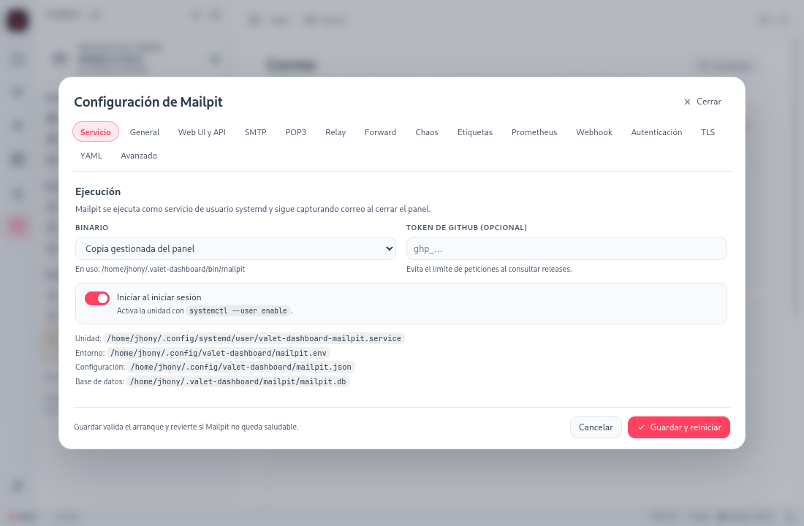

## Cómo se aplica un cambio

Al pulsar **Guardar y reiniciar**, el panel:

1. Valida claves, números, booleanos, puertos, usuarios, certificados y rutas.
2. Materializa la configuración: escribe los archivos de contraseñas, genera el certificado si
   hace falta y traduce todo a `mailpit.env`.
3. Regenera la unidad de systemd y reinicia `valet-dashboard-mailpit.service`.
4. Espera a que `/livez` responda.
5. Si Mailpit no queda saludable, **revierte** la configuración y el entorno anteriores y lo deja
   como estaba.

Si el servicio estaba detenido, los cambios se guardan sin arrancarlo. Los archivos YAML tienen su
propio botón **Guardar** y se explican más abajo.

## Servicio

| Campo | Qué hace |
|---|---|
| **Binario** | Usa la copia gestionada del panel o un `mailpit` instalado en el sistema |
| **Ruta del Mailpit del sistema** | Solo aparece con «Mailpit del sistema». Si se deja vacía, se busca en `PATH` |
| **Token de GitHub** | Opcional. Evita el límite de peticiones al consultar versiones |
| **Iniciar al iniciar sesión** | Ejecuta `systemctl --user enable` sobre la unidad |

Debajo se muestran las rutas reales de la unidad, el entorno, la configuración y la base de datos.
Se corresponden con las de [Archivos y rutas](Correo#archivos-y-rutas).

## General

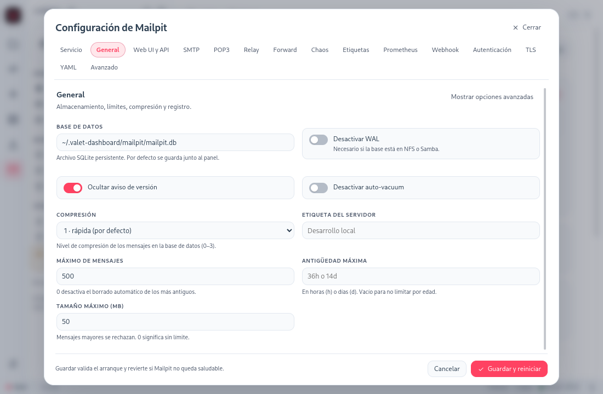

| Campo | Variable | Por defecto | Detalle |
|---|---|---|---|
| **Base de datos** | `MP_DATABASE` | `~/.valet-dashboard/mailpit/mailpit.db` | Archivo SQLite persistente |
| **Desactivar WAL** | `MP_DISABLE_WAL` | off | Necesario si la base está en NFS o Samba |
| **Ocultar aviso de versión** | `MP_DISABLE_VERSION_CHECK` | on | Evita que Mailpit consulte GitHub |
| **Desactivar auto-vacuum** | `MP_DISABLE_AUTO_VACUUM` | off | No recomendado: la base crece y se degrada |
| **Compresión** | `MP_COMPRESSION` | `1` | `0` sin compresión, `1` rápida, `2` equilibrada, `3` máxima |
| **Etiqueta del servidor** | `MP_LABEL` | vacío | Nombre visible en UI, SMTP y POP3 |
| **Tenant ID** (avanzado) | `MP_TENANT_ID` | vacío | Prefijo de tablas para aislar varias instancias en un mismo archivo |
| **Máximo de mensajes** | `MP_MAX_MESSAGES` | `500` | `0` desactiva el borrado automático |
| **Antigüedad máxima** | `MP_MAX_AGE` | vacío | Horas (`36h`) o días (`14d`); vacío no limita |
| **Tamaño máximo (MB)** | `MP_MAX_MESSAGE_SIZE` | `50` | Los mensajes mayores se rechazan; `0` sin límite |
| **Usar fechas del mensaje** (avanzado) | `MP_USE_MESSAGE_DATES` | off | Usa la fecha de la cabecera en vez de la de recepción |
| **Ignorar Message-ID duplicados** (avanzado) | `MP_IGNORE_DUPLICATE_IDS` | off | Descarta mensajes repetidos |
| **Archivo de registro** (avanzado) | `MP_LOG_FILE` | vacío | Escribe el log en archivo en vez de `journalctl` |
| **Modo silencioso** (avanzado) | `MP_QUIET` | off | Solo errores |
| **Modo detallado** (avanzado) | `MP_VERBOSE` | off | Log de depuración |

La **Base de datos** admite una ruta de archivo SQLite o una URL de [rqlite](https://rqlite.io/)
(`http://127.0.0.1:4001`). Con rqlite, la base es remota y el panel no crea ninguna carpeta. Usa
`MP_TENANT_ID` si varias instancias comparten el mismo servidor rqlite.

## Web UI y API

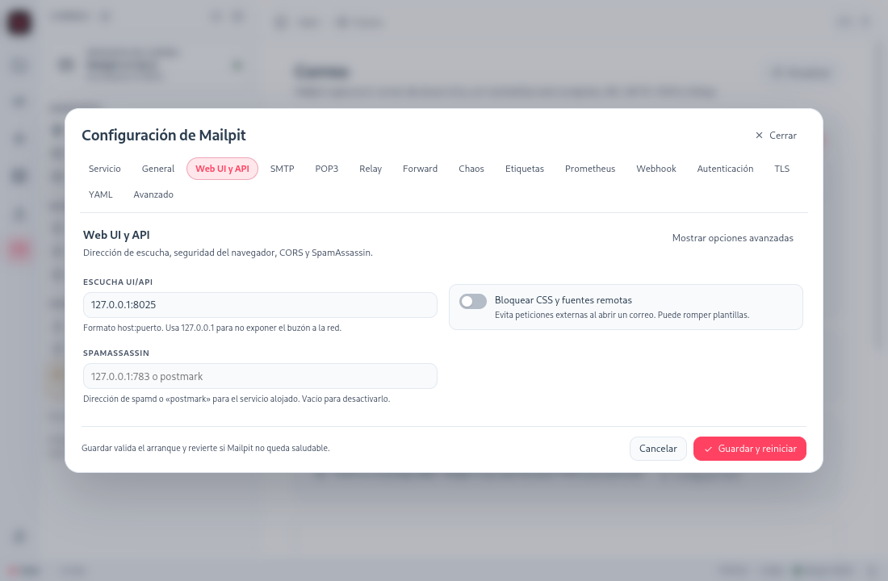

| Campo | Variable | Por defecto | Detalle |
|---|---|---|---|
| **Escucha UI/API** | `MP_UI_BIND_ADDR` | `127.0.0.1:8025` | Formato `host:puerto` |
| **Hosts permitidos** (avanzado) | `MP_ALLOWED_HOSTS` | vacío | Lista de `Host` aceptados; mitiga DNS rebinding |
| **Webroot** (avanzado) | `MP_WEBROOT` | `/` | Prefijo de la UI, por ejemplo `/mail/` |
| **CORS de la API** (avanzado) | `MP_API_CORS` | vacío | Orígenes permitidos para llamar a la API desde el navegador |
| **Bloquear CSS y fuentes remotas** | `MP_BLOCK_REMOTE_CSS_AND_FONTS` | off | Evita peticiones externas al abrir un correo; puede romper plantillas |
| **Permitir peticiones HTTP internas** (avanzado) | `MP_ALLOW_INTERNAL_HTTP_REQUESTS` | off | Necesario para Link Check, HTML Check y capturas contra hosts internos |
| **Sin límite en link check** (avanzado) | `MP_DISABLE_LINK_CHECK_RATE_LIMIT` | off | Quita el límite de peticiones del comprobador de enlaces |
| **SpamAssassin** | `MP_ENABLE_SPAMASSASSIN` | vacío | `127.0.0.1:783`, `postmark` o vacío para desactivar |
| **Aceptar TLS no confiable** (avanzado) | `MP_ALLOW_UNTRUSTED_TLS` | off | No valida certificados en link check y capturas |
| **Desactivar compresión HTTP** (avanzado) | `MP_DISABLE_HTTP_COMPRESSION` | off | |
| **Ocultar «Vaciar buzón»** (avanzado) | `MP_HIDE_DELETE_ALL_BUTTON` | off | Quita **Delete all** de la interfaz |
| **Send API acepta cualquier credencial** (avanzado) | `MP_SEND_API_AUTH_ACCEPT_ANY` | off | Solo tiene efecto si no hay archivo de auth de Send API |

## SMTP

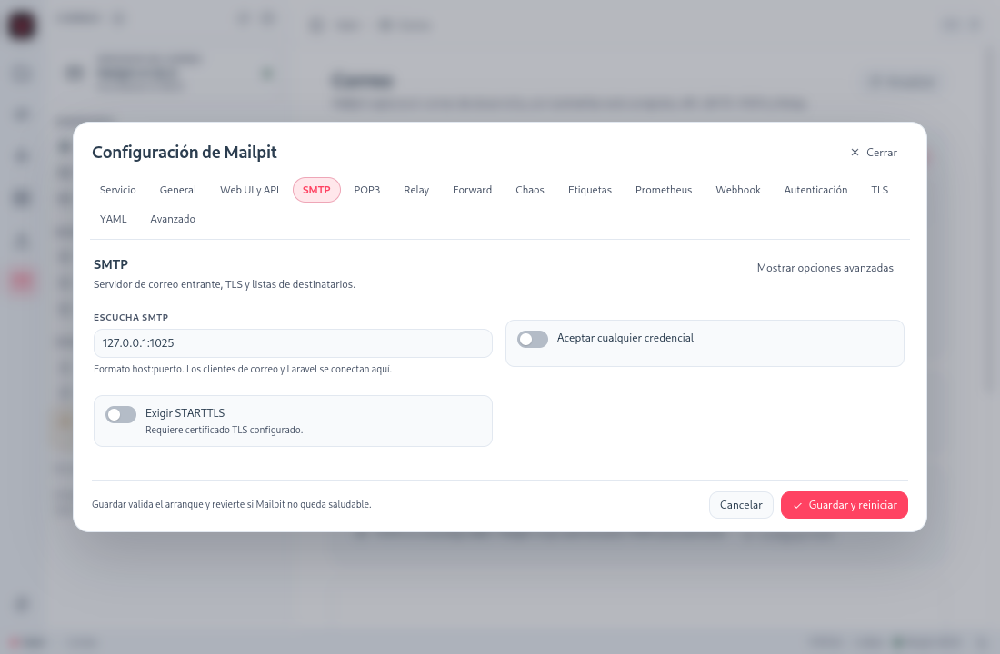

| Campo | Variable | Por defecto | Detalle |
|---|---|---|---|
| **Escucha SMTP** | `MP_SMTP_BIND_ADDR` | `127.0.0.1:1025` | Aquí se conectan Laravel, WordPress y los clientes |
| **Aceptar cualquier credencial** | `MP_SMTP_AUTH_ACCEPT_ANY` | off | Acepta cualquier usuario/contraseña, incluso ninguna |
| **Permitir auth sin TLS** (avanzado) | `MP_SMTP_AUTH_ALLOW_INSECURE` | off | Permite PLAIN/LOGIN sin STARTTLS |
| **Exigir STARTTLS** | `MP_SMTP_REQUIRE_STARTTLS` | off | Requiere certificado TLS configurado |
| **Exigir TLS directo** (avanzado) | `MP_SMTP_REQUIRE_TLS` | off | Todo el puerto va cifrado; incompatible con STARTTLS |
| **Cabeceras RFC estrictas** (avanzado) | `MP_SMTP_STRICT_RFC_HEADERS` | off | Rechaza cabeceras con saltos `\n` en vez de `\r\n` |
| **Máximo de destinatarios** (avanzado) | `MP_SMTP_MAX_RECIPIENTS` | `100` | Por mensaje |
| **Destinatarios permitidos** (avanzado) | `MP_SMTP_ALLOWED_RECIPIENTS` | vacío | Expresión regular; por ejemplo `@ejemplo\.test$` |
| **Ignorar destinatarios rechazados** (avanzado) | `MP_SMTP_IGNORE_REJECTED_RECIPIENTS` | off | Responde `250` pero descarta el mensaje |
| **Desactivar rDNS** (avanzado) | `MP_SMTP_DISABLE_RDNS` | off | Evita demoras por resolución inversa en redes de prueba |

## POP3

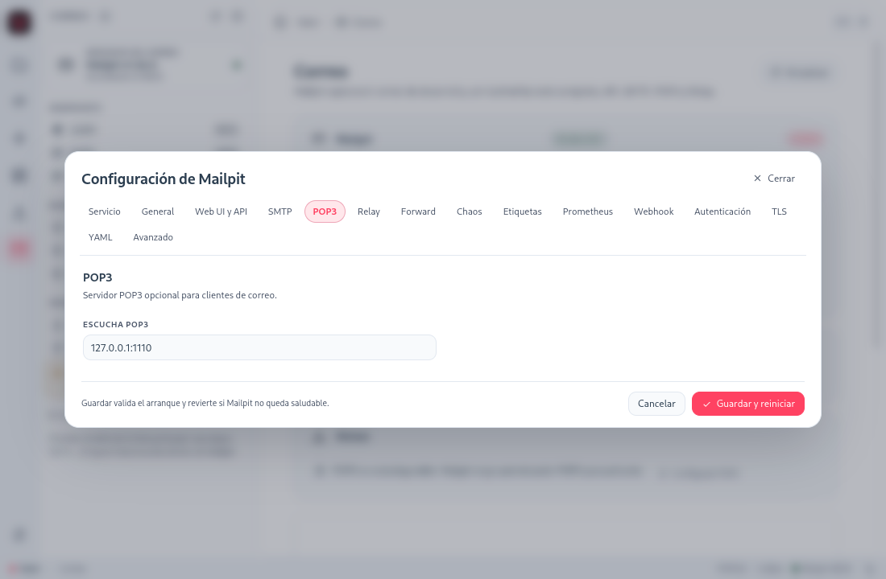

| Campo | Variable | Por defecto | Detalle |
|---|---|---|---|
| **Escucha POP3** | `MP_POP3_BIND_ADDR` | `127.0.0.1:1110` | Solo se abre si hay autenticación POP3 |

Mailpit **no arranca el servidor POP3 sin credenciales**. El panel lo explica en la página Correo
con un aviso accionable. Para activarlo:

1. Ve a **Autenticación → POP3**.
2. Actívalo y escribe usuario y contraseña.
3. Guarda. El panel crea `~/.config/valet-dashboard/mailpit/auth/pop3.htpasswd` y define
   `MP_POP3_AUTH_FILE`.
4. El puerto `1110` empieza a escuchar y el aviso desaparece.

Configuración típica de un cliente de correo:

| Ajuste | Valor |
|---|---|
| Servidor | `127.0.0.1` |
| Puerto | `1110` |
| Seguridad | Ninguna (o SSL si activas TLS) |
| Usuario / contraseña | Los que guardaste en el panel |

## Relay

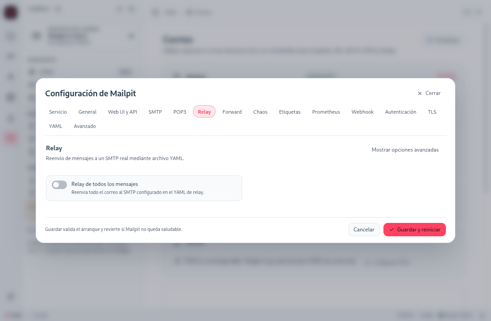

| Campo | Variable | Detalle |
|---|---|---|
| **Relay de todos los mensajes** | `MP_SMTP_RELAY_ALL` | Reenvía automáticamente todo el correo al SMTP del YAML |
| **Relay solo a estos destinatarios** (avanzado) | `MP_SMTP_RELAY_MATCHING` | Expresión regular que se aplica a los destinatarios; no se combina con el relay total |
| **Archivo de relay** (avanzado) | `MP_SMTP_RELAY_CONFIG` | Ruta del YAML; el panel la gestiona desde la pestaña **YAML** |

El Relay también habilita el botón **Release** en cada mensaje para reenviarlo a mano. La
diferencia con Forward y los ejemplos de YAML están en
[Funciones avanzadas](Correo-Avanzado#relay).

## Forward

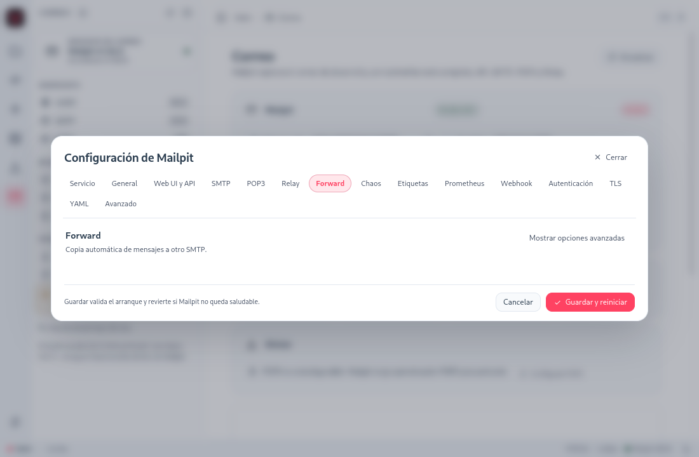

| Campo | Variable | Detalle |
|---|---|---|
| **Archivo de forward** (avanzado) | `MP_SMTP_FORWARD_CONFIG` | YAML con el destino fijo y el servidor SMTP |

Forward envía una **copia a una dirección fija**; Relay reenvía a los destinatarios originales.
Ver [Forward](Correo-Avanzado#forward).

## Chaos

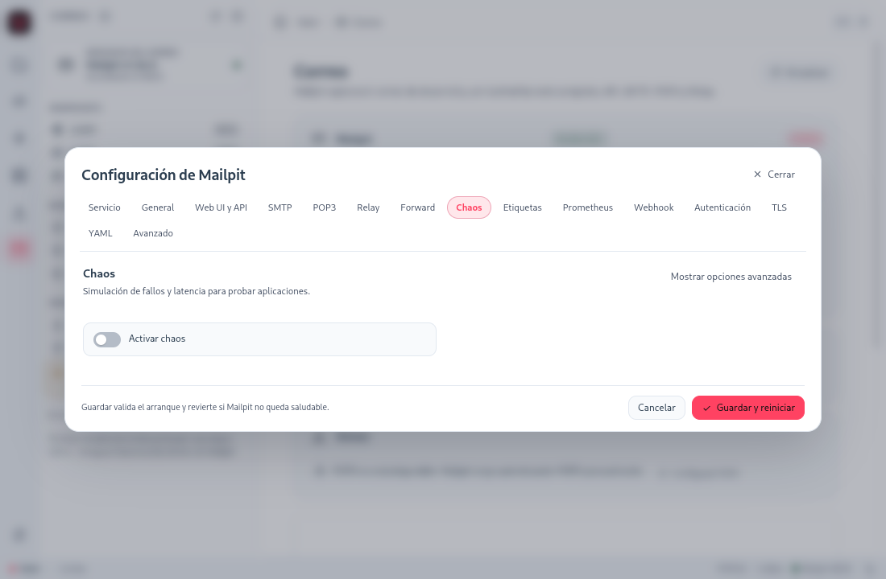

| Campo | Variable | Detalle |
|---|---|---|
| **Activar chaos** | `MP_ENABLE_CHAOS` | Habilita la simulación de fallos SMTP |
| **Disparadores** (avanzado) | `MP_CHAOS_TRIGGERS` | `etapa:código:probabilidad` separado por comas, por ejemplo `Sender:451:50,Recipient:451:20` |

Las etapas son `Sender`, `Recipient` y `Authentication`, y la probabilidad va de `0` a `100`. Si
rellenas los disparadores no hace falta marcar **Activar chaos**: definirlos ya lo activa. El campo
no acepta JSON. Ver [Chaos](Correo-Avanzado#chaos).

## Etiquetas

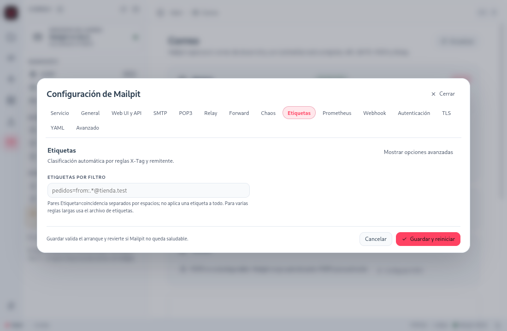

| Campo | Variable | Detalle |
|---|---|---|
| **Etiquetas por filtro** | `MP_TAG` | Reglas en línea con sintaxis `Etiqueta=coincidencia`, separadas por espacios |
| **Archivo de etiquetas** (avanzado) | `MP_TAGS_CONFIG` | YAML con reglas `match`/`tags` |
| **Etiquetas en Title Case** (avanzado) | `MP_TAGS_TITLE_CASE` | Capitaliza las etiquetas nuevas creadas por `X-Tags` o por direcciones con `+` |
| **Desactivar etiquetas** (avanzado) | `MP_TAGS_DISABLE` | `plus-addresses,x-tags` para desactivar el autotagging |
| **Etiqueta por usuario** (avanzado) | `MP_TAGS_USERNAME` | Añade una etiqueta con el usuario autenticado |

`MP_TAG` no aplica una etiqueta a todos los mensajes: define reglas `Etiqueta=coincidencia`. Un
ejemplo válido es `pedidos=from:.*@tienda.test`. Para varias reglas largas usa el YAML de
etiquetas. Ejemplos en [Etiquetas automáticas](Correo-Avanzado#etiquetas-automáticas).

## Prometheus

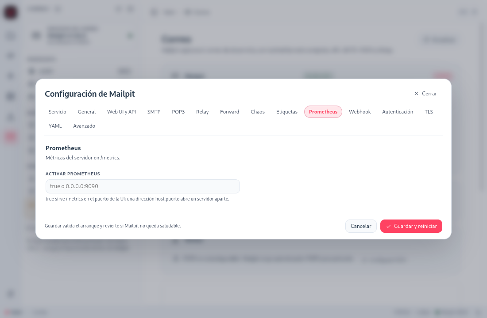

| Campo | Variable | Detalle |
|---|---|---|
| **Activar Prometheus** | `MP_ENABLE_PROMETHEUS` | `true` sirve `/metrics` en el puerto de la UI; `0.0.0.0:9090` abre un servidor aparte |

Ver [Métricas Prometheus](Correo-Avanzado#métricas-prometheus).

## Webhook

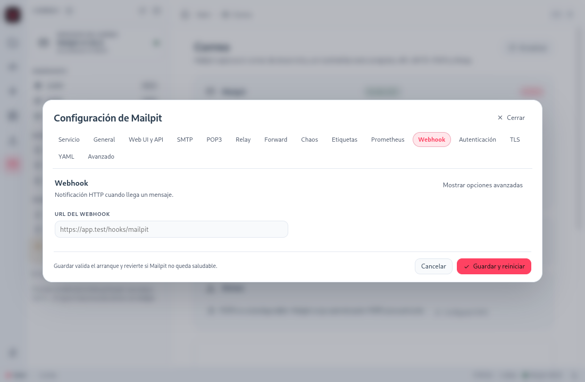

| Campo | Variable | Por defecto | Detalle |
|---|---|---|---|
| **URL del webhook** | `MP_WEBHOOK_URL` | vacío | Recibe un `POST` JSON por cada mensaje nuevo |
| **Límite de webhooks por segundo** (avanzado) | `MP_WEBHOOK_LIMIT` | `1` | `1` permite una petición por segundo; `0` desactiva el límite |
| **Retardo (segundos)** (avanzado) | `MP_WEBHOOK_DELAY` | `0` | Espera antes de llamar al webhook |

Ver [Webhook](Correo-Avanzado#webhook).

## Autenticación

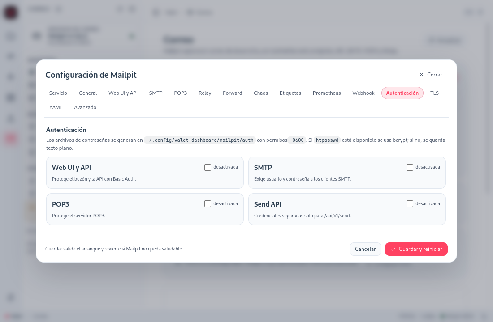

Hay cuatro grupos independientes:

| Grupo | Archivo | Variable | Protege |
|---|---|---|---|
| **Web UI y API** | `auth/ui.htpasswd` | `MP_UI_AUTH_FILE` | Bandeja y API |
| **SMTP** | `auth/smtp.htpasswd` | `MP_SMTP_AUTH_FILE` | Envío por SMTP |
| **POP3** | `auth/pop3.htpasswd` | `MP_POP3_AUTH_FILE` | Descarga por POP3 |
| **Send API** | `auth/sendApi.htpasswd` | `MP_SEND_API_AUTH_FILE` | Solo `/api/v1/send` |

Detalles:

- Los archivos se guardan en `~/.config/valet-dashboard/mailpit/auth` con permisos `0600`.
- Si `htpasswd` está instalado se usa bcrypt (`htpasswd -nbB`). Si no, la contraseña se guarda en
  texto plano dentro de un archivo privado; Mailpit lo acepta, pero es menos seguro.
- Al desactivar un grupo se borra su archivo y su variable.
- **Send API** es independiente: puedes exigir credenciales para enviar sin proteger la bandeja.
- **POP3** es obligatorio para que el servidor POP3 arranque.
- Si activas autenticación de UI, el panel rellena las credenciales en la vista embebida y en sus
  llamadas a la API.

## TLS

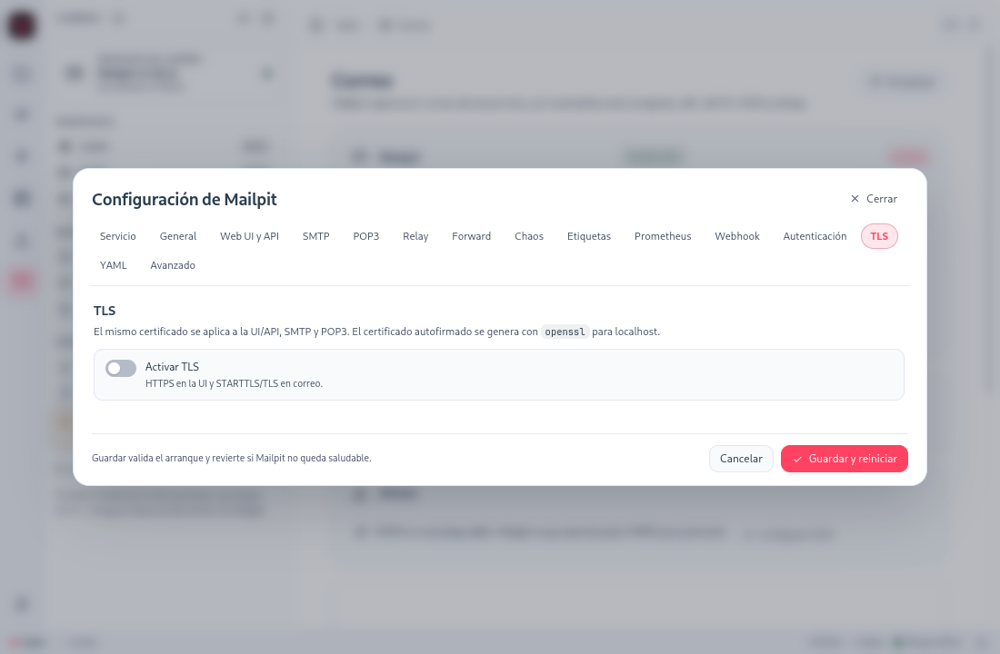

| Opción | Qué hace |
|---|---|
| **Activar TLS** | HTTPS en la UI y STARTTLS/TLS en SMTP y POP3 |
| **Certificado autofirmado** | El panel genera el certificado con `openssl` para `localhost` y `127.0.0.1` |

Con **certificado propio** indica la ruta del certificado y de la clave privada. El mismo par se
aplica a los tres servicios (`MP_UI_TLS_CERT`, `MP_SMTP_TLS_CERT`, `MP_POP3_TLS_CERT` y sus
claves).

- El certificado autofirmado se guarda en `~/.config/valet-dashboard/mailpit/tls` y se acepta
  **solo** dentro de la vista embebida. El navegador externo mostrará el aviso normal.
- Con TLS activo, el panel escribe en Laravel `MAIL_ENCRYPTION=tls` (STARTTLS). Si además activas
  **Exigir TLS directo** (`MP_SMTP_REQUIRE_TLS`), escribe `ssl`.
- En clientes de correo, usa SSL/TLS directo si activaste `MP_SMTP_REQUIRE_TLS`; en caso
  contrario, STARTTLS o «ninguna».

## YAML

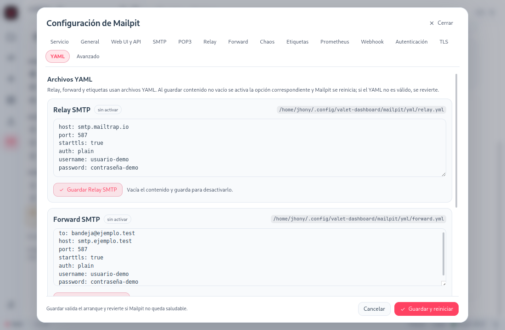

La pestaña **YAML** edita tres archivos:

| Editor | Archivo | Variable que activa |
|---|---|---|
| **Relay SMTP** | `~/.config/valet-dashboard/mailpit/yml/relay.yml` | `MP_SMTP_RELAY_CONFIG` |
| **Forward SMTP** | `~/.config/valet-dashboard/mailpit/yml/forward.yml` | `MP_SMTP_FORWARD_CONFIG` |
| **Etiquetas** | `~/.config/valet-dashboard/mailpit/yml/tags.yml` | `MP_TAGS_CONFIG` |

Funcionamiento:

1. Escribe el YAML y pulsa **Guardar** en ese editor.
2. Si el contenido no está vacío, el panel activa la variable correspondiente y reinicia Mailpit.
3. Si Mailpit no arranca (YAML inválido), el panel restaura el archivo y el entorno anteriores.
4. Para desactivar una función, **vacía el contenido y guarda**.

Los editores muestran la ruta real y una etiqueta **activo** o **sin activar**.

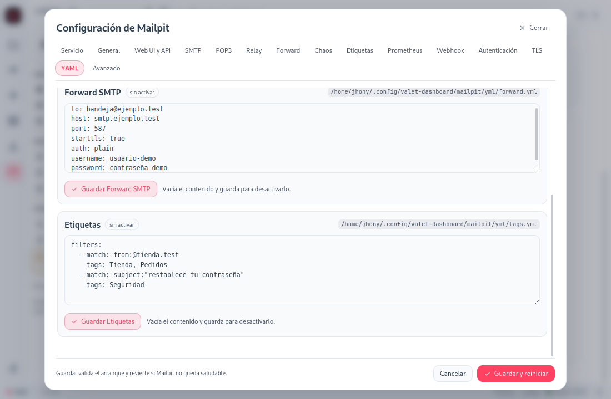

Los ejemplos completos y las claves válidas de cada archivo están en
[Funciones avanzadas](Correo-Avanzado).

## Avanzado

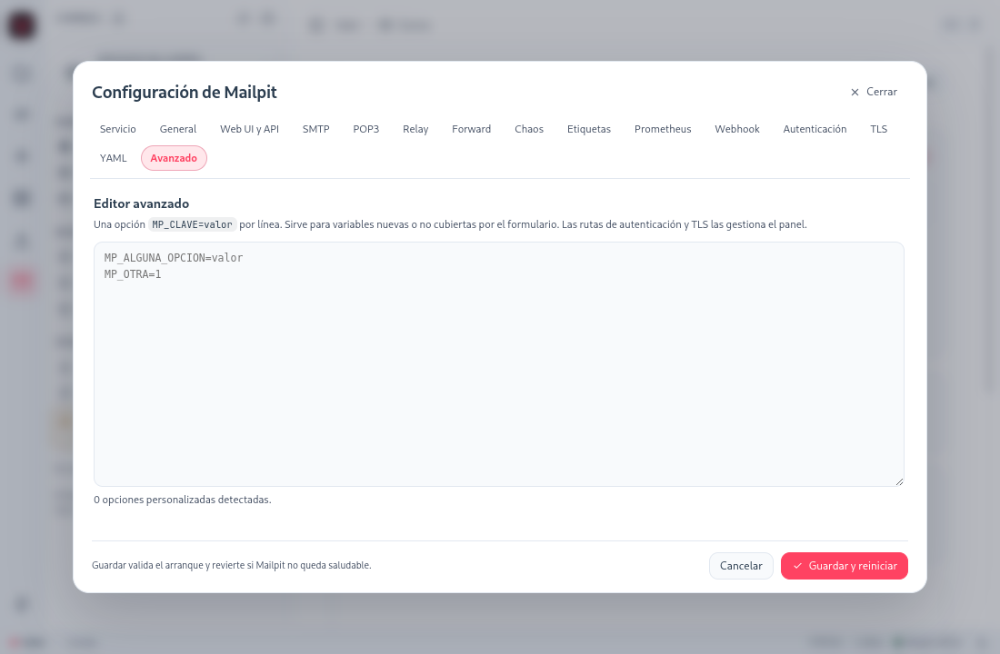

El editor avanzado acepta una opción `MP_CLAVE=valor` por línea. Sirve para variables nuevas o que
el formulario no cubre.

- Las líneas vacías y los comentarios con `#` se ignoran.
- Las rutas de autenticación y TLS **las gestiona el panel**; no las escribas aquí. Si lo haces, se
  descartan al materializar la configuración.
- Al guardar, el panel valida el formato y escribe el resultado en `mailpit.env`.

Ejemplo:

```dotenv
MP_SMTP_MAX_RECIPIENTS=50
MP_SMTP_ALLOWED_RECIPIENTS=@ejemplo\.test$
```

## Archivos que genera

| Archivo | Contenido |
|---|---|
| `~/.config/valet-dashboard/mailpit.json` | Opciones, auth, TLS y preferencias del panel |
| `~/.config/valet-dashboard/mailpit.env` | Variables `MP_*` para systemd |
| `~/.config/systemd/user/valet-dashboard-mailpit.service` | Unidad con `EnvironmentFile` |
| `~/.config/valet-dashboard/mailpit/auth/*.htpasswd` | Credenciales |
| `~/.config/valet-dashboard/mailpit/tls/` | Certificado autofirmado |
| `~/.config/valet-dashboard/mailpit/yml/*.yml` | Relay, Forward y Etiquetas |

No edites `mailpit.env` a mano: el panel lo reescribe en cada guardado.

## Relacionado

- [Correo](Correo)
- [Interfaz de Mailpit](Correo-Interfaz)
- [Funciones avanzadas](Correo-Avanzado)
- [Laravel](Correo-Laravel)
- [WordPress](Correo-WordPress)
