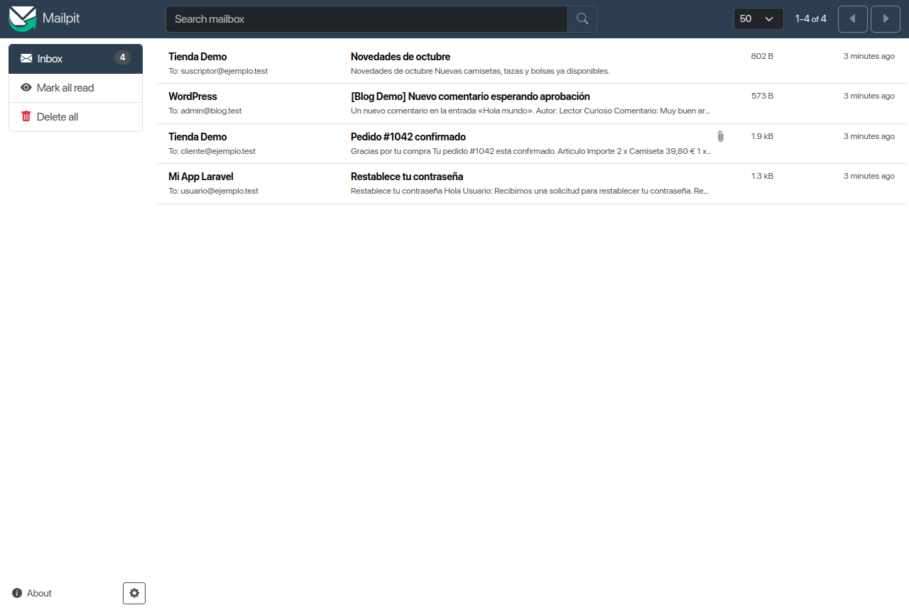
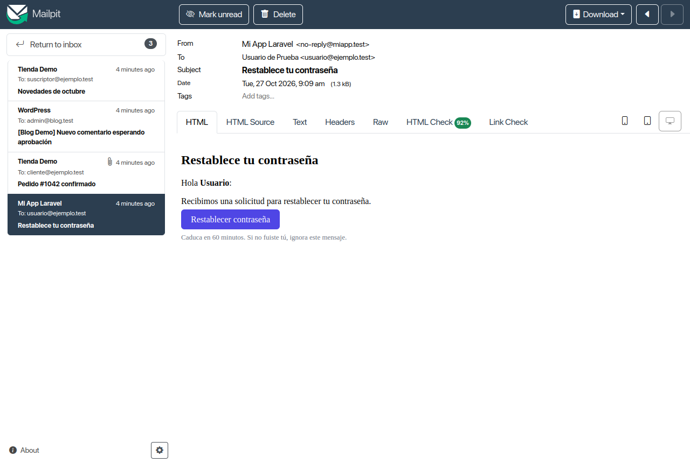
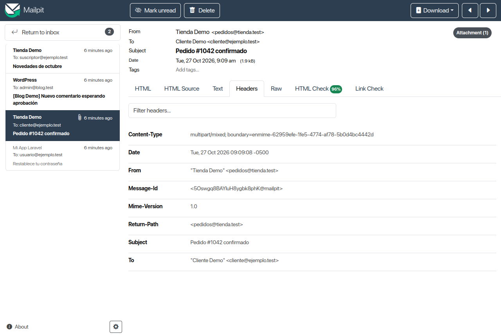
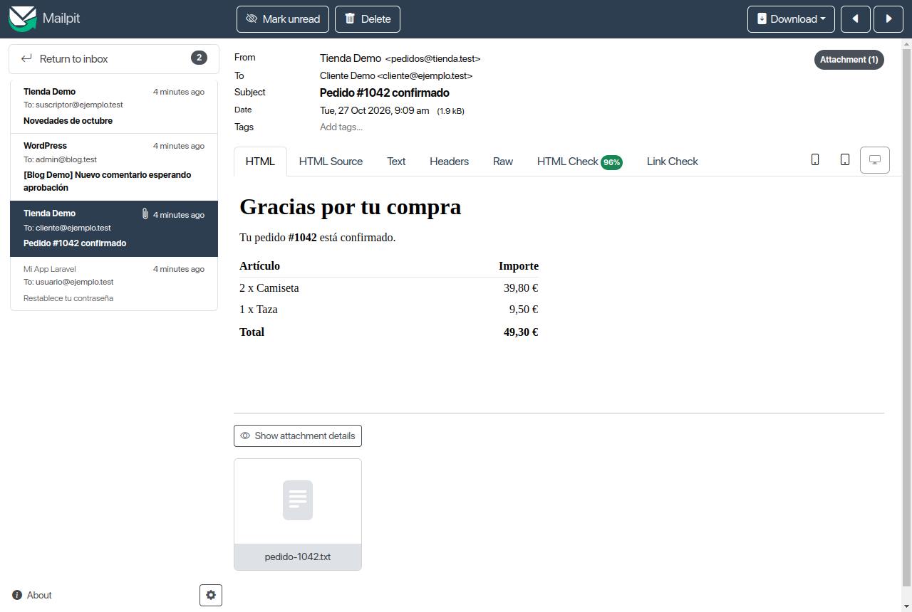
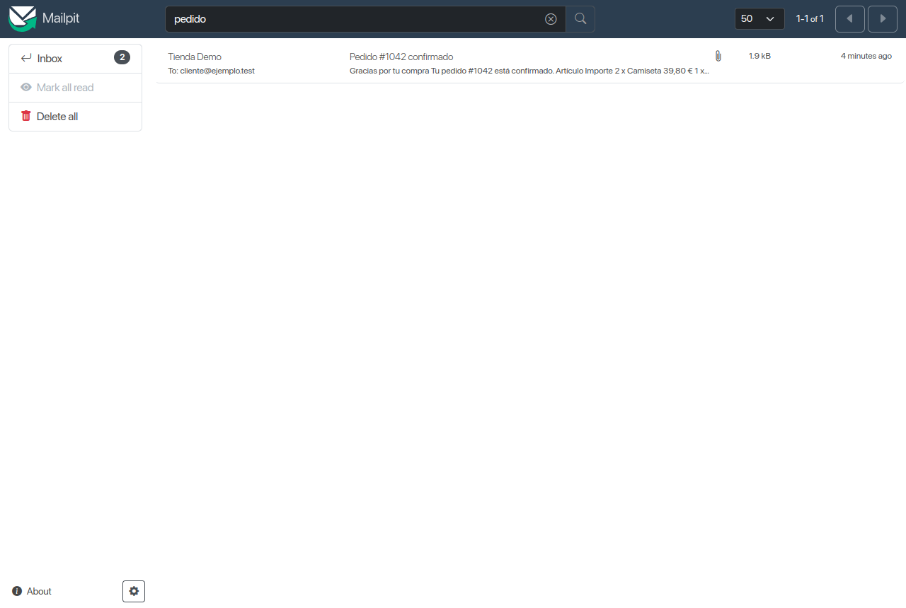
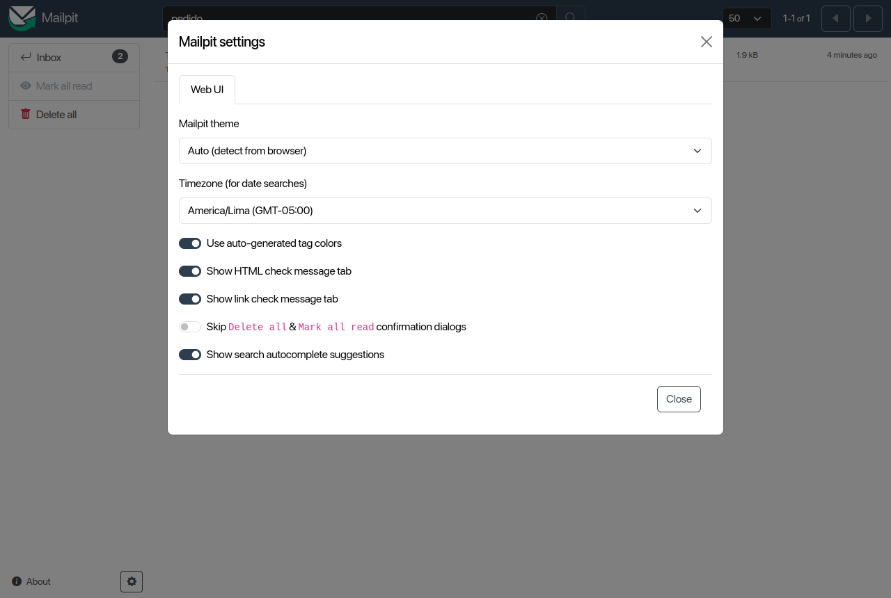

# Interfaz de Mailpit

Mailpit captura el correo y lo muestra en una bandeja web. Esta página explica cada parte de esa
interfaz y la API que hay detrás. Se abre desde **Correo** (embebida) o con **Abrir en el
navegador** en `http://127.0.0.1:8025`.

Las capturas están tomadas con Mailpit v1.32.0; en versiones anteriores algunos botones pueden
cambiar de sitio.



## La bandeja

La pantalla se divide en tres zonas:

| Zona | Contenido |
|---|---|
| Barra superior | Buscador, tamaño de página, rango visible y botones de página anterior/siguiente |
| Barra lateral | **Inbox**, etiquetas, **Mark all read**, **Delete all**, **About** y el engranaje de ajustes |
| Lista | Remitente, destinatario, asunto, extracto, tamaño, hora y clip si lleva adjuntos |

- El número del **Inbox** es la cantidad de mensajes **sin leer**.
- La lista muestra 50 mensajes por página por defecto. El desplegable permite 25, 50, 100 o 200.
- **Mark all read** marca todo como leído; **Delete all** vacía el buzón (pide confirmación). Si
  hay una búsqueda o una etiqueta activa, **Delete all** borra solo los mensajes que coinciden.
- Puedes seleccionar varios mensajes con `Ctrl`/`Cmd` o un rango con `Shift`; aparecen **Delete
  selected** y las acciones de leído/no leído sobre la selección.
- Un clip junto al tamaño indica que el mensaje lleva adjuntos.

## Leer un mensaje

Al abrir un mensaje se ven las cabeceras principales (**From**, **To**, **Subject**, **Date**,
**Tags**), los botones de acción y las pestañas de contenido.



| Acción | Qué hace |
|---|---|
| **Back** / **Return to inbox** | Vuelve a la lista |
| **Mark unread** | Lo deja como no leído |
| **Delete** | Lo elimina |
| **Download** | Descarga la fuente original del mensaje o una captura HTML |
| **Release** | Reenvía el mensaje al SMTP real configurado en Relay (solo si Relay está activo) |
| **Add tags...** | Añade o quita etiquetas en ese mensaje |

### Pestañas del mensaje

| Pestaña | Para qué sirve |
|---|---|
| **HTML** | Vista renderizada del correo, como la vería un cliente |
| **HTML Source** | Código HTML original |
| **Text** | Parte de texto plano |
| **Headers** | Todas las cabeceras, con filtro para buscar una concreta |
| **Raw** | Mensaje completo tal cual llegó (cabeceras + cuerpo + adjuntos) |
| **HTML Check** | Compatibilidad del HTML con distintos clientes de correo, con puntuación |
| **Link Check** | Comprueba los enlaces del mensaje y avisa de los rotos |
| **Spam Check** | Puntuación de SpamAssassin (solo si activas la integración) |

La pestaña **Headers** es la más útil para depurar: muestra `Message-Id`, `Content-Type`,
`Return-Path`, `Mime-Version`, etc.



### Adjuntos

Los adjuntos aparecen al final del mensaje. **Show attachment details** despliega tipo, tamaño y
opciones de descarga. Los adjuntos también se pueden descargar por API
(`GET /api/v1/message/{ID}/part/{PartID}`).



### Comprobaciones del mensaje

- **HTML Check** analiza el CSS y el HTML y calcula qué clientes lo soportan. La puntuación del
  ejemplo (92 %, 96 %) es el porcentaje de compatibilidad; al abrirla se detalla cada propiedad.
- **Link Check** hace una petición a cada enlace y marca los que fallan. Está limitado por tasa
  para no saturar; se puede desactivar el límite en **Configuración → Web UI y API**.
- **HTML screenshot** genera una captura del HTML con un navegador headless. Si la plantilla usa
  imágenes o CSS en un host interno, activa **Permitir peticiones HTTP internas**.
- **Spam Check** requiere un servidor SpamAssassin (`MP_ENABLE_SPAMASSASSIN`).

## Buscar

El buscador acepta texto libre y filtros. No distingue mayúsculas y se puede negar con `!` o `-`.



| Filtro | Ejemplo | Significado |
|---|---|---|
| Texto libre | `factura octubre` | Contiene ambas palabras, en cualquier orden |
| Frase exacta | `"restablece tu contraseña"` | Contiene la frase literal |
| Remitente | `from:@tienda.test` | El campo From coincide |
| Destinatario | `to:cliente@ejemplo.test` | El campo To coincide |
| Copia | `cc:jefe@ejemplo.test` | El campo Cc coincide |
| Copia oculta | `bcc:archivo@ejemplo.test` | El campo Bcc coincide |
| Responder a | `reply-to:hola@ejemplo.test` | El campo Reply-To coincide |
| Cualquier dirección | `addressed:cliente@ejemplo.test` | From, To, Cc, Bcc o Reply-To |
| Asunto | `subject:pedido` | Solo el asunto |
| Message-ID | `message-id:abc123@mailpit` | Identificador del mensaje |
| Etiqueta | `tag:"Pedidos"` | Mensajes con esa etiqueta |
| Leído | `is:read` | Ya leídos |
| No leído | `is:unread` | Sin leer |
| Adjuntos | `has:attachment` | Llevan adjuntos |
| Imágenes incrustadas | `has:inline` | Llevan imágenes inline |
| Etiquetados | `is:tagged` | Tienen al menos una etiqueta |
| Tamaño | `larger:2M`, `smaller:500K` | Mayores o menores que |
| Fecha | `after:2026/10/01`, `before:2026/10/31` | Rango de fechas (`aaaa/mm/dd`) |
| Negación | `subject:factura !from:@spam.test` | Excluye coincidencias |

Se pueden combinar: `subject:pedido has:attachment after:2026/10/01`.

## Etiquetas

Las etiquetas sirven para clasificar y filtrar. Se añaden de tres formas:

1. **A mano** en el mensaje: campo **Add tags...**.
2. **Cabecera `X-Tags`**: un mensaje con `X-Tags: Tienda, Pedidos` recibe ambas etiquetas.
3. **Dirección con `+`**: `pedidos+tienda@ejemplo.test` recibe la etiqueta `tienda`. Se pueden
   encadenar varias: `usuario+debug+api@ejemplo.test`.

Además, **Configuración → Etiquetas** permite reglas automáticas por remitente, asunto o
cabecera. Se documentan en [Funciones avanzadas](Correo-Avanzado#etiquetas-automáticas).

Las etiquetas aparecen en la barra lateral. Al hacer clic en una se filtra la bandeja; con
`Ctrl`/`Cmd` puedes combinar varias. **Tags → Edit tags** permite renombrarlas o eliminarlas.

## Ajustes de la interfaz

El engranaje de la esquina inferior izquierda abre **Mailpit settings**. Estos ajustes se guardan
en el navegador, no en el archivo de configuración del servidor.



| Ajuste | Efecto |
|---|---|
| **Mailpit theme** | Tema Auto, claro, oscuro o «deep dark» |
| **Timezone** | Zona horaria para las búsquedas por fecha |
| **Use auto-generated tag colors** | Color automático para etiquetas nuevas |
| **Show HTML check message tab** | Muestra u oculta la pestaña HTML Check |
| **Show link check message tab** | Muestra u oculta la pestaña Link Check |
| **Skip Delete all & Mark all read confirmation dialogs** | Quita la confirmación de esas acciones |
| **Show search autocomplete suggestions** | Sugerencias mientras escribes en el buscador |

## Notificaciones

Mailpit avisa de los mensajes nuevos por tres vías, todas con la interfaz abierta:

| Vía | Cómo funciona |
|---|---|
| **Favicon** | El icono de la pestaña lleva un contador de no leídos (solo escritorio) |
| **Toast** | Aviso abajo a la derecha al llegar un mensaje; se cierra solo y abre el correo al pulsarlo |
| **Notificaciones del navegador** | Se activan con la campana de abajo a la izquierda; requieren `localhost` o HTTPS |

Al activar las notificaciones del navegador, los *toasts* se desactivan. Las tres dependen del
WebSocket de Mailpit: si pones un proxy delante, enruta también el WebSocket.

## API HTTP

La API sirve para automatizar pruebas, vaciar el buzón o comprobar que un correo llegó. La
documentación interactiva está en `http://127.0.0.1:8025/api/v1/`.

| Método | Ruta | Uso |
|---|---|---|
| `GET` | `/api/v1/info` | Versión, mensajes, no leídos, tamaño y uptime |
| `GET` | `/api/v1/messages` | Lista paginada (`start`, `limit`) |
| `DELETE` | `/api/v1/messages` | Vacía el buzón |
| `PUT` | `/api/v1/messages` | Marca leídos o no leídos (por IDs o por búsqueda) |
| `GET` | `/api/v1/message/{ID}` | Resumen de un mensaje |
| `GET` | `/api/v1/message/{ID}/headers` | Cabeceras |
| `GET` | `/api/v1/message/{ID}/raw` | Fuente completa |
| `GET` | `/api/v1/message/{ID}/part/{PartID}` | Adjunto |
| `GET` | `/api/v1/message/{ID}/part/{PartID}/thumb` | Miniatura de un adjunto de imagen |
| `GET` | `/api/v1/message/{ID}/html-check` | Resultado del HTML Check |
| `GET` | `/api/v1/message/{ID}/link-check` | Resultado del Link Check |
| `GET` | `/api/v1/message/{ID}/sa-check` | Resultado de SpamAssassin |
| `GET` | `/view/{ID}.html`, `/view/{ID}.txt` | Cuerpo HTML o de texto del mensaje |
| `POST` | `/api/v1/message/{ID}/release` | Reenvía por el Relay |
| `GET` | `/api/v1/search?query=...` | Búsqueda con la misma sintaxis |
| `DELETE` | `/api/v1/search?query=...` | Borra los mensajes que coinciden |
| `POST` | `/api/v1/send` | Envía un mensaje sin SMTP |
| `GET` | `/api/v1/tags` | Lista de etiquetas |
| `PUT` | `/api/v1/tags` | Asigna etiquetas a una lista de mensajes (sobrescribe) |
| `PUT` | `/api/v1/tags/{Tag}` | Renombra una etiqueta |
| `DELETE` | `/api/v1/tags/{Tag}` | Elimina una etiqueta (no borra los mensajes) |
| `GET`/`PUT` | `/api/v1/chaos` | Estado y configuración de Chaos |
| `GET` | `/api/v1/webui` | Configuración de la interfaz |
| `GET` | `/livez`, `/readyz` | Salud del servicio |

Ejemplos:

```bash
# Cuántos mensajes hay
curl -s http://127.0.0.1:8025/api/v1/info

# Los últimos 10 mensajes
curl -s "http://127.0.0.1:8025/api/v1/messages?limit=10"

# Buscar por asunto
curl -s "http://127.0.0.1:8025/api/v1/search?query=subject:pedido"

# Leer la fuente de un mensaje
curl -s http://127.0.0.1:8025/api/v1/message/3GTB71QrrSk5VmErhOaPBC/raw

# Vaciar el buzón
curl -X DELETE http://127.0.0.1:8025/api/v1/messages

# Etiquetar un mensaje (las etiquetas van por /tags, no por /messages)
curl -X PUT http://127.0.0.1:8025/api/v1/tags \
  -H 'Content-Type: application/json' \
  -d '{"IDs":["3GTB71QrrSk5VmErhOaPBC"],"Tags":["Pedidos","Tienda"]}'
```

Si activas autenticación de UI, añade `-u usuario:contraseña` a todas las llamadas. Si activas la
autenticación específica de Send API, `/api/v1/send` usa esas credenciales y el resto sigue usando
las de la UI.

### Enviar por API

```bash
curl -X POST http://127.0.0.1:8025/api/v1/send \
  -H 'Content-Type: application/json' \
  -d '{
    "From": {"Email": "pedidos@tienda.test", "Name": "Tienda"},
    "To": [{"Email": "cliente@ejemplo.test", "Name": "Cliente"}],
    "Subject": "Pedido #1042 confirmado",
    "Text": "Gracias por tu compra.",
    "HTML": "<h1>Gracias por tu compra</h1><p>Tu pedido <b>#1042</b> está confirmado.</p>"
  }'
```

La API también acepta `Cc`, `Bcc`, `ReplyTo`, `Headers` y `Attachments` (nombre, tipo y contenido
en base64). El límite de tamaño es el de **General → Tamaño máximo**.

## Límites del buzón

- **Máximo de mensajes** (500 por defecto): al superarlo se borran los más antiguos. `0` desactiva
  el borrado automático.
- **Antigüedad máxima**: por ejemplo `36h` o `14d`.
- **Tamaño máximo**: 50 MB por defecto; los mensajes mayores se rechazan.

Se cambian en [Configuración → General](Correo-Configuracion#general).

## Relacionado

- [Correo](Correo)
- [Configuración](Correo-Configuracion)
- [Funciones avanzadas](Correo-Avanzado)
- [Laravel](Correo-Laravel)
- [WordPress](Correo-WordPress)
