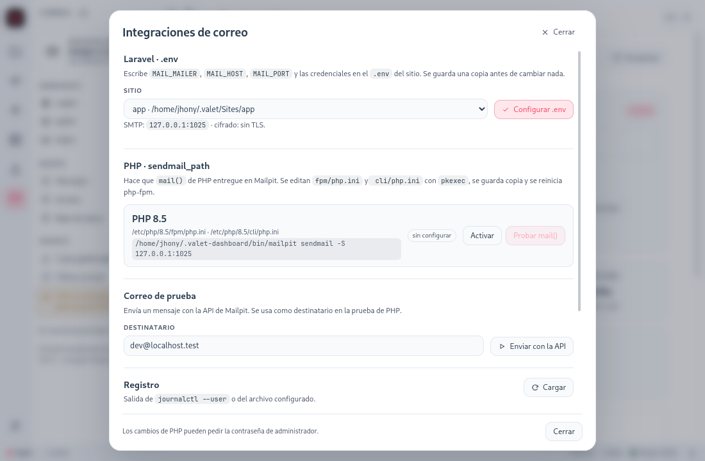

# Laravel con Mailpit

Mailpit sustituye al servidor SMTP real en desarrollo: Laravel envía igual que siempre, pero el
correo se queda en el buzón local. Nada sale a Internet.

## Configuración automática desde el panel

1. Abre **Correo → Integraciones**.
2. En **Laravel · .env**, elige el sitio.
3. Pulsa **Configurar .env**.



El panel escribe estas claves en el `.env` del sitio:

```dotenv
MAIL_MAILER=smtp
MAIL_HOST=127.0.0.1
MAIL_PORT=1025
MAIL_USERNAME=null
MAIL_PASSWORD=null
MAIL_ENCRYPTION=null
```

| Clave | Valor | Motivo |
|---|---|---|
| `MAIL_MAILER` | `smtp` | Usa SMTP, no `log` ni `array` |
| `MAIL_HOST` | `127.0.0.1` | Mailpit escucha en local |
| `MAIL_PORT` | Puerto SMTP real | `1025` salvo que lo hayas cambiado |
| `MAIL_USERNAME` / `MAIL_PASSWORD` | `null` o las credenciales SMTP | Depende de **Autenticación → SMTP** |
| `MAIL_ENCRYPTION` | `null`, `tls` o `ssl` | Depende de **TLS** y de **Exigir TLS directo** |
| `MAIL_SCHEME` | `smtp` o `smtps` | Solo si la clave ya existe (Laravel 11+) |

En Laravel 11 y 12 la clave que decide el cifrado es `MAIL_SCHEME`; `MAIL_ENCRYPTION` se mantiene
por compatibilidad con Laravel 10 y anteriores.

Detalles del proceso:

- Si una clave ya existe, **reemplaza esa línea**; si no existe, la añade al final.
- Si el sitio no tiene `.env`, parte de `.env.example` y crea el `.env`.
- Antes de tocar un `.env` existente guarda una copia en
  `~/.valet-dashboard/backups/<fecha>/env/`.
- El archivo queda con permisos `0600`.

Después de configurar, limpia la caché de configuración:

```bash
php artisan config:clear
```

Si tenías `config:cache` activo, vuelve a generarla o Laravel seguirá usando los valores viejos:

```bash
php artisan config:cache
```

## Configuración manual

Si prefieres editar el `.env` a mano, estos son los tres casos habituales.

### Sin autenticación ni TLS (por defecto)

```dotenv
MAIL_MAILER=smtp
MAIL_HOST=127.0.0.1
MAIL_PORT=1025
MAIL_USERNAME=null
MAIL_PASSWORD=null
MAIL_ENCRYPTION=null
```

En Laravel 11 o superior, si tu `config/mail.php` usa `MAIL_SCHEME`:

```dotenv
MAIL_SCHEME=smtp
```

### Con autenticación SMTP

Activa **Configuración → Autenticación → SMTP** y usa las mismas credenciales:

```dotenv
MAIL_MAILER=smtp
MAIL_HOST=127.0.0.1
MAIL_PORT=1025
MAIL_USERNAME=valet
MAIL_PASSWORD=tu-contraseña
MAIL_ENCRYPTION=null
```

Si Mailpit exige TLS para autenticar, activa TLS y usa `MAIL_ENCRYPTION=tls`.

### Con TLS

```dotenv
MAIL_MAILER=smtp
MAIL_HOST=127.0.0.1
MAIL_PORT=1025
MAIL_USERNAME=null
MAIL_PASSWORD=null
MAIL_ENCRYPTION=tls
```

Con **Exigir TLS directo** (`MP_SMTP_REQUIRE_TLS`), el puerto pasa a ser TLS desde el inicio:

```dotenv
MAIL_ENCRYPTION=ssl
MAIL_SCHEME=smtps
```

En Laravel 11+ añade también `MAIL_SCHEME=smtp` si usas STARTTLS: es la clave que lee
`config/mail.php`.

El certificado autofirmado del panel no es de confianza para PHP. Para desarrollo local es más
simple dejar TLS desactivado; si lo necesitas, usa un certificado propio y confía en él en el
sistema.

## Comprobar que funciona

### Con Tinker

```bash
php artisan tinker
```

```php
Mail::raw('Si ves este mensaje, Laravel está usando Mailpit.', function ($message) {
    $message->to('tu@ejemplo.test')
            ->subject('Prueba desde Laravel');
});
```

Abre `http://127.0.0.1:8025` y busca **Prueba desde Laravel**.

### Con una ruta temporal

```php
// routes/web.php
Route::get('/probar-correo', function () {
    Mail::raw('Correo de prueba', fn ($m) => $m->to('tu@ejemplo.test')->subject('Hola Mailpit'));
    return 'Enviado';
});
```

### Por la API de Mailpit

```bash
curl -s http://127.0.0.1:8025/api/v1/info
```

El campo `Messages` debe haber aumentado. También puedes contar desde Laravel:

```php
$total = Http::get('http://127.0.0.1:8025/api/v1/info')->json('Messages');
```

## Un Mailable completo

```bash
php artisan make:mail OrderConfirmed --markdown=emails.orders.confirmed
```

```php
namespace App\Mail;

use App\Models\Order;
use Illuminate\Bus\Queueable;
use Illuminate\Mail\Mailable;
use Illuminate\Mail\Mailables\Content;
use Illuminate\Mail\Mailables\Envelope;
use Illuminate\Queue\SerializesModels;

class OrderConfirmed extends Mailable
{
    use Queueable, SerializesModels;

    public function __construct(public Order $order) {}

    public function envelope(): Envelope
    {
        return new Envelope(subject: "Pedido #{$this->order->id} confirmado");
    }

    public function content(): Content
    {
        return new Content(markdown: 'emails.orders.confirmed');
    }
}
```

```blade
{{-- resources/views/emails/orders/confirmed.blade.php --}}
<x-mail::message>
# Gracias por tu compra

Tu pedido **#{{ $order->id }}** está confirmado.

<x-mail::button :url="route('orders.show', $order)">
Ver pedido
</x-mail::button>

Total: {{ number_format($order->total, 2, ',', '.') }} €
</x-mail::message>
```

```php
Mail::to($order->customer->email)->send(new OrderConfirmed($order));
```

### Con adjuntos

```php
use Illuminate\Mail\Mailables\Attachment;

public function attachments(): array
{
    return [
        Attachment::fromPath(storage_path('app/facturas/factura.pdf'))
            ->as('factura.pdf')
            ->withMime('application/pdf'),
    ];
}
```

El adjunto aparece en el mensaje de Mailpit y se puede descargar desde la pestaña del mensaje.

## Colas

Si el correo va por cola, el worker también necesita la misma configuración:

```bash
php artisan queue:work
```

Comprueba que el worker se reinició después de cambiar el `.env`. Un worker viejo mantiene la
configuración anterior en memoria.

Para probar sin cola:

```dotenv
QUEUE_CONNECTION=sync
```

## Pruebas automatizadas

`Mail::fake()` **no envía a Mailpit**: intercepta el correo dentro de Laravel. Úsalo para probar la
lógica:

```php
Mail::fake();

$this->post('/pedidos', [...])->assertRedirect();

Mail::assertSent(OrderConfirmed::class, fn ($mail) => $mail->order->id === 42);
```

Si quieres comprobar el correo **real** en Mailpit, no uses `Mail::fake()` y consulta la API:

```php
use Illuminate\Support\Facades\Http;

$response = Http::get('http://127.0.0.1:8025/api/v1/search', [
    'query' => 'subject:"Pedido #42 confirmado"',
]);

$this->assertSame(1, $response->json('messages_count'));
```

Vacía el buzón entre pruebas:

```php
Http::delete('http://127.0.0.1:8025/api/v1/messages');
```

## Laravel Sail o Docker

Dentro de un contenedor, `127.0.0.1` es el propio contenedor, no tu equipo. Opciones:

- Usa el nombre del servicio de Mailpit en la red de Docker.
- Usa `host.docker.internal` si el contenedor lo resuelve.
- Publica el puerto y apunta al host:

```dotenv
MAIL_HOST=host.docker.internal
MAIL_PORT=1025
```

El CLI `devenv mail --env` ya escribe el alias correcto cuando el proyecto corre en la red
`devenv`.

## Problemas habituales

| Síntoma | Causa | Solución |
|---|---|---|
| `Connection refused` en `127.0.0.1:1025` | Mailpit detenido o puerto distinto | Arráncalo en **Correo** y revisa el puerto en **Configuración → SMTP** |
| `535 Authentication failed` | Auth SMTP activa y credenciales incorrectas | Vuelve a **Configurar .env** o copia las credenciales de **Autenticación → SMTP** |
| El correo no aparece | `MAIL_MAILER=log`, `.env` cacheado o cola sin worker | Revisa el `.env`, ejecuta `php artisan config:clear` y arranca el worker |
| Error de certificado | TLS activo con certificado autofirmado | Desactiva TLS en local o usa un certificado propio de confianza |
| Llega a otro buzón | `.env` de otro entorno o `MAIL_HOST` remoto | Comprueba `MAIL_HOST`, `MAIL_PORT` y que no haya variables de entorno del sistema que ganen |
| Los tests no ven correo | `Mail::fake()` activo | Es lo esperado: usa la API solo en pruebas de integración |

## Relacionado

- [Correo](Correo)
- [Interfaz de Mailpit](Correo-Interfaz)
- [Configuración](Correo-Configuracion)
- [WordPress](Correo-WordPress)
