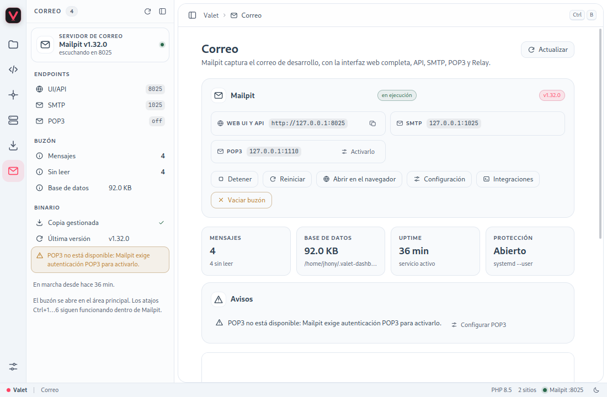

# Correo

La pestaña **Correo** instala y ejecuta [Mailpit](https://mailpit.axllent.org/), un servidor de
correo de desarrollo que **captura todos los mensajes** y no los entrega a Internet. Incluye la
interfaz web de Mailpit embebida en el panel, API HTTP, SMTP, POP3 opcional, Relay, Forward,
etiquetas, Chaos, métricas y webhook.

Mailpit es independiente de Valet y del panel: se ejecuta como **servicio de usuario de systemd**
(`systemctl --user`) y sigue capturando correo aunque cierres Valet Dashboard.



## Qué puedes hacer desde aquí

| Función | Dónde | Detalle |
|---|---|---|
| Leer el buzón | Área principal | [Interfaz de Mailpit](Correo-Interfaz) |
| Buscar, etiquetar y revisar un correo | Interfaz embebida | [Interfaz de Mailpit](Correo-Interfaz) |
| Cambiar puertos, límites, auth, TLS y YAML | **Configuración** | [Configuración](Correo-Configuracion) |
| Reenviar, simular fallos, métricas y webhook | **Configuración** | [Funciones avanzadas](Correo-Avanzado) |
| Conectar un proyecto Laravel | **Integraciones** | [Laravel](Correo-Laravel) |
| Conectar un sitio WordPress | Plugin o mu-plugin | [WordPress](Correo-WordPress) |
| Enviar un correo de prueba | **Integraciones** | [Correo de prueba](#correo-de-prueba) |
| Importar mensajes `.eml` existentes | Terminal | [Importar mensajes](Correo-Avanzado#importar-mensajes) |
| Ver el registro del servicio | **Integraciones → Registro** | [Registro y mantenimiento](Correo-Avanzado#registro-y-mantenimiento) |

## Primer uso

1. Abre **Correo** en la barra de actividad (`Ctrl+6`).
2. Pulsa **Instalar Mailpit**. El panel consulta la última versión estable en GitHub, descarga el
   binario de tu arquitectura y verifica su SHA-256.
3. Al terminar, la unidad `valet-dashboard-mailpit.service` queda habilitada y arrancada.
4. La interfaz web aparece embebida en el área principal. Si prefieres el navegador, usa
   **Abrir en el navegador**.

Si ya tienes un `mailpit` en el sistema, el panel lo detecta y muestra **Usar el del sistema**. El
botón sigue disponible después de instalar la copia gestionada: sirve para volver al binario del
sistema en cualquier momento. En **Configuración → Servicio** puedes cambiar entre la copia
gestionada y una ruta concreta.

Cuando hay una versión nueva aparece **Actualizar a vX.Y.Z**. La actualización descarga el binario,
lo valida, reinicia el servicio y guarda el anterior como `mailpit.prev` para poder revertir.

## Endpoints por defecto

| Servicio | Dirección | Uso |
|---|---|---|
| Web UI y API | `http://127.0.0.1:8025` | Bandeja, visor de mensajes y API `/api/v1` |
| SMTP | `127.0.0.1:1025` | Aplicaciones, Laravel, WordPress y clientes de correo |
| POP3 | `127.0.0.1:1110` | Clientes que descargan correo por POP3 (opcional) |

Los tres puertos se cambian en **Configuración → Web UI y API / SMTP / POP3**. El panel comprueba
que sean distintos y que no estén reservados para DNS, DHCP, NTP o mDNS.

**POP3 está desactivado por diseño.** Mailpit no abre el puerto si no existe un archivo de
autenticación POP3. La página lo indica con el aviso «POP3 no está disponible» y un botón
**Configurar POP3** que abre la pestaña **Autenticación**. Al guardar usuario y contraseña, el
puerto `1110` empieza a escuchar. Ver [Autenticación](Correo-Configuracion#autenticación).

## La bandeja embebida

La bandeja se muestra con una vista de Electron (`WebContentsView`) sobre la página Correo, no con
un `iframe`:

- Usa una partición propia (`persist:mailpit`), `sandbox`, aislamiento de contexto y sin
  integración con Node.
- Los enlaces externos se abren en el navegador del sistema.
- Los atajos `Ctrl+1`…`Ctrl+6`, `Ctrl+B` y `Ctrl+,` siguen funcionando dentro de la vista.
- La vista se oculta al abrir un diálogo o cambiar de sección.
- Si activas autenticación de UI, el panel rellena las credenciales por ti.
- Si activas TLS con certificado autofirmado, el panel acepta ese certificado **solo** para la
  vista embebida. El navegador externo seguirá mostrando el aviso habitual.

La interfaz completa se documenta en [Interfaz de Mailpit](Correo-Interfaz).

## El panel lateral

Mientras estás en Correo, la barra lateral resume el estado:

- **Servidor de correo**: versión y puerto de la UI, con un punto verde si está en ejecución.
- **Endpoints**: UI/API, SMTP y POP3. POP3 muestra `off` si no está activo.
- **Buzón**: mensajes, sin leer y tamaño de la base SQLite.
- **Binario**: copia gestionada o del sistema, última versión disponible, TLS y Auth de UI.
- **Avisos**: el primero de los avisos; el panel principal los muestra todos.
- **Uptime**: tiempo desde el último arranque.

## Correo de prueba

**Integraciones → Correo de prueba → Enviar con la API** envía un mensaje a la dirección que
indiques usando `POST /api/v1/send`. Sirve para comprobar que el servicio captura correo sin
depender de Laravel ni de WordPress.

```bash
curl -X POST http://127.0.0.1:8025/api/v1/send \
  -H 'Content-Type: application/json' \
  -d '{
    "From": {"Email": "dev@localhost.test", "Name": "Prueba"},
    "To": [{"Email": "tu@ejemplo.test"}],
    "Subject": "Prueba de Mailpit",
    "Text": "Si ves esto, Mailpit captura correo."
  }'
```

## Archivos y rutas

| Ruta | Contenido |
|---|---|
| `~/.config/systemd/user/valet-dashboard-mailpit.service` | Unidad de usuario |
| `~/.config/valet-dashboard/mailpit.json` | Configuración del panel |
| `~/.config/valet-dashboard/mailpit.env` | Variables `MP_*` que lee systemd |
| `~/.config/valet-dashboard/mailpit/auth/` | Archivos de contraseñas (`0600`) |
| `~/.config/valet-dashboard/mailpit/tls/` | Certificado autofirmado |
| `~/.config/valet-dashboard/mailpit/yml/` | Relay, Forward y Etiquetas |
| `~/.valet-dashboard/bin/mailpit` | Binario gestionado |
| `~/.valet-dashboard/bin/mailpit.prev` | Binario anterior para revertir |
| `~/.valet-dashboard/mailpit/mailpit.db` | Buzón SQLite |
| `~/.valet-dashboard/backups/<fecha>/` | Copias de `.env` y `php.ini` |

## Seguridad

- Por defecto la UI, SMTP y POP3 escuchan **solo en `127.0.0.1`**.
- Si cambias la escucha a `0.0.0.0`, el panel muestra un aviso: cualquiera en la red podría leer el
  buzón o enviar correo.
- Activa autenticación y TLS si vas a exponer el servicio fuera de localhost.
- El buzón contiene correo real de pruebas: puede incluir tokens de restablecimiento, enlaces
  mágicos y datos personales. Vacíalo cuando termines.
- **Desinstalar** detiene y elimina la unidad y el binario gestionado. La configuración y el buzón
  se conservan salvo que marques **Borrar también los correos almacenados**.

## Problemas habituales

| Síntoma | Causa probable | Qué hacer |
|---|---|---|
| `systemctl --user no está disponible` | Sesión sin bus de usuario (SSH, contenedor) | Inicia sesión en el escritorio o usa el binario del sistema manualmente |
| `GitHub respondió 403` | Límite de peticiones de la API | Añade un token en **Configuración → Servicio** |
| La descarga falla al verificar SHA-256 | Descarga corrupta o proxy | Reintenta; revisa la conexión y el proxy |
| Mailpit no queda saludable | Puerto ocupado, YAML inválido, TLS incorrecto | Revisa **Integraciones → Registro** (`journalctl --user -u valet-dashboard-mailpit`) |
| POP3 no escucha | Falta el archivo de autenticación POP3 | **Correo → Configurar POP3** y guarda credenciales |
| PHP no entrega correo | `sendmail_path` no aplicado o php-fpm sin reiniciar | Vuelve a activar sendmail y usa **Probar mail()** |
| Laravel no usa Mailpit | `.env` cacheado | Ejecuta `php artisan config:clear` |
| WordPress no usa Mailpit | No hay mu-plugin o plugin SMTP configurado | Ver [WordPress](Correo-WordPress) |

## Relacionado

- [Interfaz de Mailpit](Correo-Interfaz)
- [Configuración](Correo-Configuracion)
- [Funciones avanzadas](Correo-Avanzado)
- [Laravel](Correo-Laravel)
- [WordPress](Correo-WordPress)
- [Servicios](Servicios)
- [Seguridad y copias](Seguridad-y-copias)
- [Arquitectura](Arquitectura)
- [Solución de problemas](Solucion-de-problemas)
